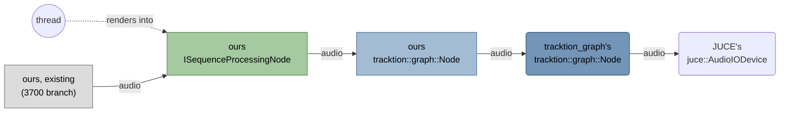
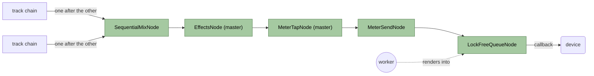
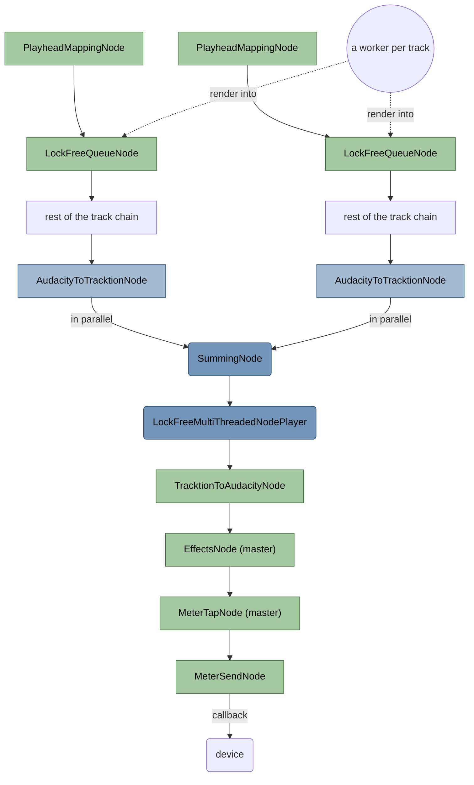
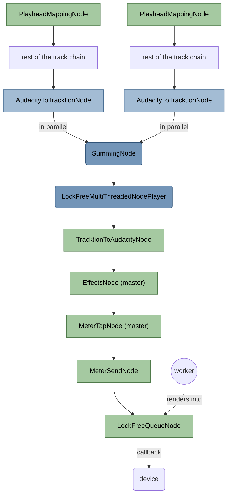
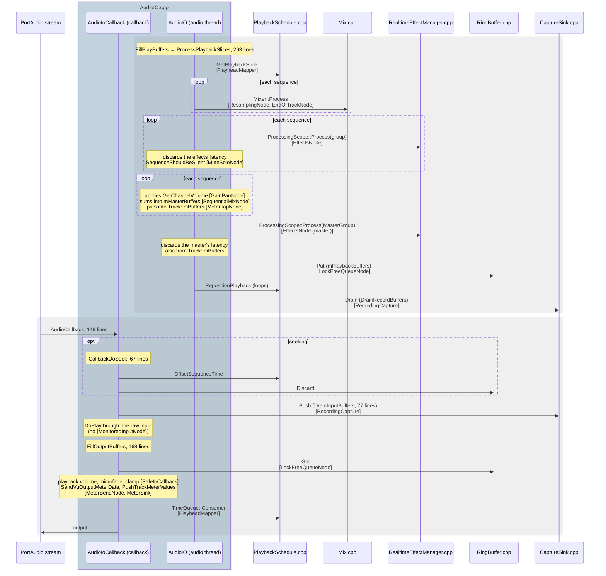

# Safe/fast mode switch

## Goal

An audio engine, `Au4AudioEngine`, next to AudioIO, on PortAudio or JUCE devices, with one set of nodes arranged two ways,
chosen in the engine dropdown:

- **Safe mode**, `SafeIoCallback` ("PortAudio (safe)", "JUCE (safe)"): everything renders ahead of the device on a worker, behind one queue, as
  AudioIO. Peaks are absorbed; what isn't rendered in time plays late. Mute/solo/effect changes are heard after the queue:
  0.2–0.25 s measured (PortAudio: 0.47–0.59 s, same Linux/PipeWire setup). Input monitoring plays the raw input through.
- **Fast mode**, `FastIoCallback` ("PortAudio (fast)", "JUCE (fast)"): clips are read ahead per track on workers; mixing and effects run in the
  device callback. Mute/solo/effect changes are heard within a block; the input can be monitored through the effects. What
  isn't rendered in time is skipped.

Mixing can be sequential (one thread) or parallel (tracktion_graph's player over a thread pool). The JUCE-only build has no
tracktion dependency: it mixes sequentially, in both arrangements.

## Starting point (3700 branch)

- `IAudioEngine`: what the app plays, records and monitors through; AudioIO over PortAudio implements it.
- AudioIO: an audio thread renders each playback sequence (its graph, see below), then its realtime effects, mute/solo and
  volume/pan, into a ring buffer; the device callback copies from it.
- `ISequenceProcessingNode`: a node of a sequence's graph, read with `GetSamples(start, len)`. Each playback sequence comes with
  its graph, which does the clip processing: reading the samples, time stretching, fades, envelopes.

## New building blocks

In `src/au3audio/internal/au4` (namespace `au::au4`), except where said.

| Block                                                | Role                                                                                                                                                                                     |
| ---------------------------------------------------- | ---------------------------------------------------------------------------------------------------------------------------------------------------------------------------------------- |
| `Au4AudioEngine : public au::audio::IAudioEngine`    | Counterpart to `Au3AudioEngine`, on the devices its `IDeviceOpener` opens: one instance per audio library                                                                                |
| `IDevice`, `IDeviceOpener`                           | An open audio device, which calls back an `IDeviceCallback`; what opens them as the audio settings say                                                                                   |
| `PortAudioDevice` (`internal/portaudio`)             | PortAudio's, opened as AudioIO opens its streams (`PortAudioStream`, au3)                                                                                                                |
| `JuceDevice` (`internal/juce`)                       | JUCE's                                                                                                                                                                                   |
| `IoCallback`                                         | Base of the two below, implements `IDeviceCallback`                                                                                                                                      |
| `SafeIoCallback`                                     | Safe mode: one `LockFreeQueueNode` renders the master's chain ahead                                                                                                                      |
| `FastIoCallback`                                     | Fast mode: the master's chain runs in the callback; a `LockFreeQueueNode` per track renders its `PlayheadMappingNode` ahead                                                              |
| `MonitoringCallback`                                 | Idle monitoring: meters the input, plays it through, raw or through the effects                                                                                                          |
| `PlayheadMapper : IPlayheadMapper` (au3)             | Maps linear stream indices to the timeline positions the playhead reads: seeks, loops                                                                                                    |
| `PlayheadMappingNode` (au3)                          | Reads a sequence's graph by stream index, where an `IPlayheadMapper` says                                                                                                                |
| `ResamplingNode` (au3)                               | Converts a sequence's rate to the device's                                                                                                                                               |
| `LockFreeQueueNode` (au3)                            | Renders its input ahead on its own worker thread, into a lock-free queue read by stream index; on a seek, drops what it queued                                                           |
| `Track`                                              | Not a node: a track's chain (below) as the callback keeps it: the chain's output for the mixer, its queue in fast mode, its meter tap                                                    |
| `EndOfTrackNode`                                     | Silences the track where it ends: past the play range's end unless looping (`IEndOfTrackContext`), or where a lead-in recording starts; before the effects, so that their tails ring out |
| `EffectsNode`                                        | A group's realtime effects (a track's or the master's), through its `IEffectsContext`: reads its input ahead by their latency and primes them when reading jumps                         |
| `MuteSoloNode`                                       | Silences the track as mute/solo say, whether another track solos coming from its `IMuteSoloContext`                                                                                      |
| `GainPanNode`                                        | Volume/pan; where a mono track becomes stereo                                                                                                                                            |
| `MeterTapNode`                                       | Keeps what passes, and its stream index, for a meter                                                                                                                                     |
| `MeterSendNode`                                      | Tops the master's chain: once a block has rendered, writes every tap's capture to the `MeterSink`, on the thread that renders                                                            |
| `MeterSink`                                          | Not a node: lock-free, by stream index; the callback forwards to the meters what it plays, stamped when it's heard                                                                       |
| `SequentialMixNode`                                  | Sums its inputs one after the other: the tracks, or the monitored track's source and the input                                                                                           |
| `MonitoredInput`                                     | Fast mode: not a node: the input of the block being rendered, with the input volume                                                                                                      |
| `MonitoredInputNode`                                 | Fast mode: the input as a source, live where its chain renders the block; a `SequentialMixNode` sums it with the monitored track's source                                                |
| `AudacityToTracktionNode` (M2, `internal/tracktion`) | Any `ISequenceProcessingNode` (here a track's chain) as a node of tracktion's graph                                                                                                      |
| `TracktionToAudacityNode` (M2, `internal/tracktion`) | Tracktion's graph as an `ISequenceProcessingNode`: runs a `LockFreeMultiThreadedNodePlayer` over a stream range                                                                          |

## Why a graph

| Code                                    | Lines |
| --------------------------------------- | ----- |
| Shared by both modes (`IoCallback`)     | 399   |
| Safe mode only (`SafeIoCallback`)       | 59    |
| Fast mode only (`FastIoCallback`)       | 63    |

Safe mode and fast mode aren't two engines: they're two arrangements of the same parts. AudioIO hard-codes one
arrangement.

- Order matters (`EndOfTrackNode` before effects, meter tap after volume/pan, monitored input before effects)
- AudioIO: enforced by its code layout
- Graph: enforced by the graph-building code (`buildTrack`) → tested, as are the nodes

## Milestones

In the diagrams, arrows follow the audio. Rectangles are ours; rounded ones come with JUCE or tracktion_graph. Grey is
what we have already; the other colours say what a new node implements.

### M1: safe mode

`SafeIoCallback` with `SequentialMixNode`. No tracktion_graph.

A track, and the master, are chains of nodes rather than one renderer. The callback builds the tracks and keeps them as
`Track` structs: the chain's output, which the mixer pulls; the track's queue, in fast mode, to start it and drop what
it holds on a seek or loop change; its meter tap. A `Track` owns its chain through its output (nodes own their inputs), and
the mixer shares it.

```mermaid
flowchart LR
    C[sequence's graph] --> S[PlayheadMappingNode] --> End[EndOfTrackNode] --> FX[EffectsNode] --> MS[MuteSoloNode] --> GP[GainPanNode] --> Meter[MeterTapNode]
    style S fill:#a5c9a1,stroke:#4f7a4a,color:#000
    style End fill:#a5c9a1,stroke:#4f7a4a,color:#000
    style FX fill:#a5c9a1,stroke:#4f7a4a,color:#000
    style MS fill:#a5c9a1,stroke:#4f7a4a,color:#000
    style GP fill:#a5c9a1,stroke:#4f7a4a,color:#000
    style Meter fill:#a5c9a1,stroke:#4f7a4a,color:#000
    style C fill:#dcdcdc,stroke:#707070,color:#000
```

- What a node needs beyond its input, it gets from a context it's given at construction:
    - `IEffectsContext`: processes a group's effects on buffers, in the current block's processing scope; their latency.
    - `IMuteSoloContext`: whether any track solos, this block.
    - `IEndOfTrackContext`: where the play range ends, unless looping.
- Meters. The app's meters take one producer thread, while chains render on the worker, the callback or the pool's threads;
  and in safe mode, what renders is heard 0.2–0.25 s later, or never if a seek drops it. So:
    - `MeterTapNode` only captures, on the thread that renders its chain.
    - `MeterSendNode`, last in the master's chain, writes the block's captures to the `MeterSink` once everything below has
      rendered, on the thread that pulls it.
    - The callback, as it outputs a stream index, forwards that index's captures to the meters, stamped with when it's
      heard. Paused or late, the stamps are right; what a seek or loop change drops is never metered. In fast mode the
      sink passes straight through.

### M2: fast mode, mixing with tracktion's graph; the switch

`FastIoCallback`, with the tracks summed in tracktion's graph: `TracktionToAudacityNode` runs a `LockFreeMultiThreadedNodePlayer`
over a `SummingNode` of `AudacityToTracktionNode`s.

- `ISequenceProcessingNode` doesn't report latency, and so will `AudacityToTracktionNode : tracktion::graph::Node`: atm our nodes compensate their own
- Two interchangeable mixers, both `ISequenceProcessingNode`s, without a common base: `SequentialMixNode` (`au4`) and
  `TracktionToAudacityNode` (`au4tracktion`). The factory picks one; the master's chain follows it.
- `MonitoredInputNode`: the input monitored through the effects, which a `SequentialMixNode` sums with the monitored
  track's source, before its `EffectsNode`.
- The switch: an `Au4AudioEngine` per audio library, each with the two factories and registered as two backends
  ("PortAudio (safe)" and "PortAudio (fast)", "JUCE (safe)" and "JUCE (fast)"), which set its mode when activated; switching restarts the stream as switching engines does. The device and the
  audio settings are shared. Whether the input is monitored through the effects goes with the factory.

### M3 (optional): safe mode with parallel mixing

M1's callback with M2's parallel mixer: tracks, clip processing included, render in parallel ahead of the device. Absorbs
peaks like M1 and spreads sustained load like M2. The safe mode's factory with `TracktionToAudacityNode`, where tracktion_graph
is built.

## Reuse

- M1 → M2: nothing of M1 is thrown away; M2 adds the fast mode's callback, `TracktionToAudacityNode`, `AudacityToTracktionNode`,
  `MonitoredInput` and `MonitoredInputNode`, the switch. M1's callback can be a single class, its base appearing with the
  fast mode's.
- M2 → M3: nothing thrown away; M3 is a combination.

## Acceptance

Measured on the proof of concept (see the appendix), RelWithDebInfo, with a test effect loading the CPU:

|                                       | 4 tracks, sustained load per track | Load spikes                 | Seek gap |
| ------------------------------------- | ---------------------------------- | --------------------------- | -------- |
| PortAudio                             | Starves from 30%                   | Absorbed                    |          |
| Safe mode, sequential (M1)            | Starves from 30%, as PortAudio     | Absorbed                    | 12 ms    |
| Fast mode, sequential                 | Late callbacks from 20–30%         | One late callback per spike | ~0.1 s   |
| Fast mode, parallel (tracktion_graph) | Clean up to 80%                    | One late callback per spike | ~0.1 s   |

- M1 must match PortAudio, at least.
- M2 must match the fast mode, parallel figures, and monitor live through the effects, idle and recording.

## Open points

- The mode per workspace (e.g. fast in Music and Modern): left out for now; the dropdown chooses.
- The pool's threads in the callback: a thread per CPU, the device's included, as tracktion_engine; realtime priority for
  the pool's threads?
- In M3 the mix should render whole queue chunks, not device blocks, or the pool synchronizes every few milliseconds.

## Appendix: proof of concept

On the `tracktion-audio-engine` branch, based on the 3700 branch. Its backends, chosen in the audio preferences or a toolbar
dropdown: PortAudio, JUCE (worker), JUCE (device) and Tracktion. Names there: `IoCallback` is `JucePlaybackStream` and its
base `PlaybackStream`, `SafeIoCallback` is `JuceWorkerPlaybackStream`, `FastIoCallback` is `JuceDevicePlaybackStream`,
`MonitoringCallback` is `MonitoringStream`, `IPlayheadMapper` is `PlaybackScheduleNode::ISchedule`, `PlayheadMapper` is
`StreamPlayHead` (with its adapter `StreamPlayHead::Schedule`), `PlayheadMappingNode` is `PlaybackScheduleNode`,
`SequentialMixNode` is `MixNode` (which also runs the master's effects there), `Track` is `TrackNode` (a node there, with
`SequenceRenderer` doing what the chain does).

Its Tracktion backend works as the fast mode, with parallel mixing, but with nodes of its own (`TracktionPlaybackStream`,
`SequenceNode`, `MasterNode`, adapters to tracktion's play head, `PendingFrames`). It is the A/B reference for M2, which replaces
it. The branch's history is to be rebuilt along the milestones, each class introduced under its final name.

Not prototyped yet: `AudacityToTracktionNode` and `TracktionToAudacityNode` (M2), the chains' nodes (`EndOfTrackNode`, `EffectsNode`, `MuteSoloNode`,
`GainPanNode`, `MeterTapNode`) and their contexts, `MeterSendNode` and `MeterSink`, `PlayheadMapper` implementing `IPlayheadMapper` directly, the switch.

## The same in AudioIO

What does each block's job in `Au3AudioEngine`'s playback (`au3/libraries/au3-audio-io` and the libraries it calls). AudioIO
always renders on its audio thread (`AudioIO::AudioThread`) and plays what it rendered through one ring buffer per channel,
as the safe mode does.

In the diagram, the arrows are calls, to code with a class and file of its own; the notes on `AudioIO.cpp` are what it
does itself, inline in its functions (the file has 3127 lines; the functions' lengths are given). In brackets, our block
that does the same.

